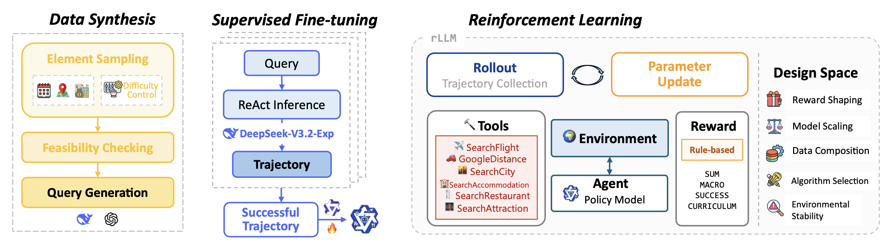
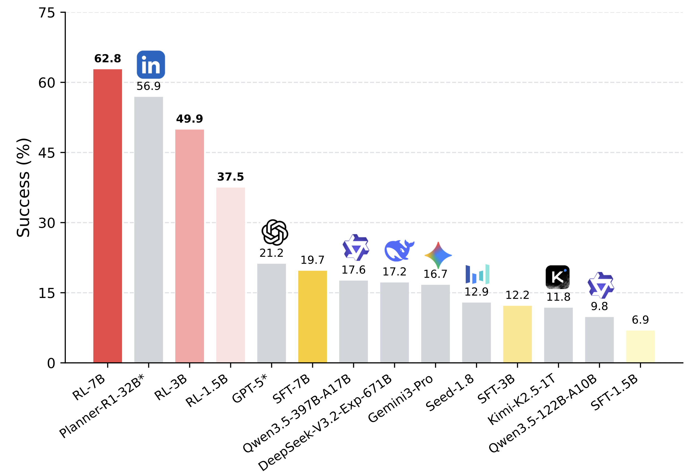

# Agent-STAR 

<p align="center">
   <a href="https://arxiv.org/abs/2603.21972"></a>
   <a href="https://huggingface.co/datasets/xxwu/Agent-STAR-TravelDataset"></a>
   <a href="https://huggingface.co/collections/xxwu/agent-star"></a>
   <a href="RL/README_AGENTSTAR_RL.md"></a>
   
</p>


This repository is the official implementation of our paper: **Demystifying Reinforcement Learning for Long-Horizon Tool-Using Agents: A Comprehensive Recipe**.

We use [TravelPlanner](https://github.com/OSU-NLP-Group/TravelPlanner/) as a long-horizon tool-use testbed, where agents must iteratively call tools to satisfy multifaceted constraints, i.e., commonsense and hard constraints. We implement **STAR [Data Synthesis → SFT → RL]**, a unified post-training pipeline that systematically studies the agentic RL design space across five axes: reward shaping, model scaling, data composition, algorithm selection, and environmental stability.



> Please consider citing or giving a 🌟 if Agent-STAR is helpful to your work! 

```
@misc{wu2026agentstar,
      title={Demystifying Reinforcement Learning for Long-Horizon Tool-Using Agents: A Comprehensive Recipe}, 
      author={Xixi Wu and Qianguo Sun and Ruiyang Zhang and Chao Song and Junlong Wu and Yiyan Qi and Hong Cheng},
      year={2026},
      eprint={2603.21972},
      archivePrefix={arXiv},
      primaryClass={cs.LG},
      url={https://arxiv.org/abs/2603.21972}, 
}
```


### 🎙️ News 

🎉 **[2026-08-22]** Our paper is **accepted by EMNLP 2026**!

🏋️ **[2026-08-22]** We release the **full RL training framework and scripts** under [`RL/`](RL/), covering TravelPlanner RL training and out-of-domain inference on BrowseComp-Plus and Knowledge-Intensive QA.

📑 **[2026-03-24]** Our paper is released on arXiv!

🌱 **[2026-03-23]** We release the data synthesis and inference framework of our STAR-pipeline, along with three STAR-SFT models and three STAR-RL models. 

> 👀 Stay tuned for continuous updates, new STAR checkpoints will be added over time!

---

<div align="center">

### 🏋️ RL code is live — start here

**[📘 RL Guide (English)](RL/README_AGENTSTAR_RL.md)** &nbsp;•&nbsp; **[📗 RL 使用文档 (中文)](RL/README_AGENTSTAR_RL_zh.md)**

*Environment setup · reward configuration · training scripts for 1.5B / 3B / 7B · checkpoint export · OOD inference*

</div>

---

## 📖 Table of Contents 

- [📚 Dataset](#-dataset)
- [🔧 Environment](#-environment)
- [🤗 Model](#-model)
- [🚀 Run Inference](#-run-inference)
- [🏋️ RL Training](#rl-training)
- [📮 Contact](#-contact)
- [🙏 Acknowledgements](#-acknowledgements)


## 📚 Dataset 

We open-source our data synthesis codes and **17K+** synthetic queries.

Synthetic datasets are available at https://huggingface.co/datasets/xxwu/Agent-STAR-TravelDataset.

|Data|Description|
|---|---|
|[TravelPlanner_Val180.jsonl](https://huggingface.co/datasets/xxwu/Agent-STAR-TravelDataset/blob/main/TravelPlanner_Val180.jsonl)|Official TravelPlanner validation set of 180 instances|
|[TravelTotal_17K.jsonl](https://huggingface.co/datasets/xxwu/Agent-STAR-TravelDataset/blob/main/TravelTotal_17K.jsonl)|All **17K+** synthetic queries after element sampling, feasibility checking, and back-translation|
|[Travel_Mixed_1K_RL.jsonl](https://huggingface.co/datasets/xxwu/Agent-STAR-TravelDataset/blob/main/Travel_Mixed_1K_RL.jsonl)|Default **1K** RL training set with **mixed difficulty**|
|Travel_{Difficulty}_1K.jsonl|Difficulty-specific **1K** sets, i.e., Easy / Medium / Hard for controlled experiments|

To generate your own training samples, follow the three-step pipeline:

* **Step 0 - Prepare the travel database**
  * Download: https://huggingface.co/datasets/xxwu/Agent-STAR-TravelDatabase
  * Put all CSV files under `database/`.

* **Step 1 - Element sampling**

  ```shell
  cd DataSynthesis
  python3 step1_generate_dict.py --generate_dict --easy_num 1000 --medium_num 1000 --hard_num 1000
  ```

* **Step 2 - Feasibility checking**

  Merge the sampled files into a single file, e.g., `combine_3k.jsonl`, then:
  ```shell
  python3 step2_dict_feasibility.py --path output/combine_3k.jsonl
  ```
  Output files: `*_feasible.jsonl` and `*_failed.jsonl`.

* **Step 3 - Query generation**

  Use LLM back-translation to turn feasible JSON elements into natural language TravelPlanner queries 

  Fill API keys in `step3_generate_query.py` first:

  ```shell
  python3 step3_generate_query.py --input_file output/combine_3k_feasible.jsonl --output_file output/combine_3k_final.jsonl
  ```


## 🔧 Environment

For inference, the required packages are:

```
vllm==0.11.0
transformers==4.57.3
torch==2.8.0
```

Before running the inference, you have to download the [travel database](https://huggingface.co/datasets/xxwu/Agent-STAR-TravelDatabase), and put all the CSV files under the `database` folder.

If you use commercial LLMs like Gemini3-Pro, Seed-1.8 / Seed-2.0, Kimi-K2.5, DeepSeek-V3.2, Qwen3-397B-A17B, etc, fill up the corresponding API keys in `Inference/config.json`.


## 🤗 Model

We release both the **STAR-SFT** and **STAR-RL** tuned models across **1.5B / 3B / 7B** scales for reproducing and further research.

Backbones: **Qwen2.5-Instruct**.

SFT: fine-tune from the Qwen2.5-Instruct base using **1K successful trajectories**, which are generated by **DeepSeek-V3.2-Exp-Thinking** on synthetic queries. The corresponding SFT scripts are provided under `SFTScripts/`. The scripts are based on `LLaMAFactory==0.9.4.dev0`.

RL: we follow the paper’s scale-aware recipe, as smaller models benefit from curriculum-style rewards and exploration-heavy algorithms, while 7B can leverage GRPO with the dense SUM reward for stronger performance and faster convergence.


|Model|Path|
|-----|-----|
|Agent-STAR-SFT-1.5B|https://huggingface.co/xxwu/Agent-STAR-SFT-1.5B|
|Agent-STAR-SFT-3B|https://huggingface.co/xxwu/Agent-STAR-SFT-3B|
|Agent-STAR-SFT-7B|https://huggingface.co/xxwu/Agent-STAR-SFT-7B|
|Agent-STAR-RL-1.5B|https://huggingface.co/xxwu/Agent-STAR-RL-1.5B|
|Agent-STAR-RL-3B|https://huggingface.co/xxwu/Agent-STAR-RL-3B|
|Agent-STAR-RL-7B|https://huggingface.co/xxwu/Agent-STAR-RL-7B|




The figure summarizes TravelPlanner test-set success across training variants and model scales.

## 🚀 Run Inference

The inference code lives under `Inference/`. The pipeline is:
**ReAct inference** → **Post-processing [NL → structured JSON]** → **Evaluation**.

### Quick scripts

We provide ready-to-use scripts under `Inference/scripts/`:
* `infer_sotamodel.sh`: run inference with strong commercial LLMs 
* `infer_testset.sh`: deploy a local model using vLLM and run inference on the TravelPlanner test set

### Step-by-step

* **Step 0: Prepare the environment**
  * Put the TravelPlanner travel [CSVs](https://huggingface.co/datasets/xxwu/Agent-STAR-TravelDatabase) under `database/`.
  * If you use commercial LLMs, fill `Inference/config.json` including API endpoints and keys.

* **Step 1: Run ReAct inference** 

  From the repo root, you can run:
  ```shell
  cd Inference
  python3 -u main.py \
    --model YOUR_MODEL_PATH_OR_NAME \
    --save_suffix YOUR_SUFFIX \
    --max_workers 20 \
    --split validation  # or test
    --max_context 32768 \
    --max_turns 60 
  ```

  If you want to run inference on your own synthesized dataset, add:
  `--use_custom_query --input_file YOUR_FILE.jsonl`.

* **Step 2: Post-processing to format plans into the evaluation JSON**
  
  Set the DashScope API key used by `Inference/utils.py`:

  ```shell
  export DASHSCOPE_API_KEY="YOUR_DASHSCOPE_API_KEY"
  python3 -u post_process.py \
    --path PREDICTIONS.jsonl \
    --split validation  # or test
    --format_model deepseek-v3.2-exp
  ```

  `post_process.py` converts the model’s natural-language itinerary into the strict JSON format used by the evaluators.

  **⚠️ IMPORTANT & 🚨 REWARD-HACKING PREVENTION**
    * For test set, `post_process.py` runs `utils.py::format_planning_for_official_test` to normalize `transportation`, i.e., `driving/...` → `Self-driving`, so TravelPlanner’s checker matches correctly.
    * For local evaluation like validation set, we use `Inference/eval_commonsense.py::detect_transportation_type` for **stricter transport matching**.


* **Step 3: Evaluation**
  * Validation set: 
    ```
    python3 -u eval.py --path YOUR_FORMATTED.jsonl --save_score
    ```
    
  * Test set: 
  
    Use the official TravelPlanner [leaderboard](https://huggingface.co/spaces/osunlp/TravelPlannerLeaderboard)


<a id="rl-training"></a>

## 🏋️ RL Training

The RL code lives under [`RL/`](RL/), built on [rLLM](https://github.com/rllm-org/rllm/) with a lightly patched `verl==0.5.0` vendored in `RL/verl/`.

> 📘 **Full documentation: [RL Guide (English)](RL/README_AGENTSTAR_RL.md) · [RL 使用文档 (中文)](RL/README_AGENTSTAR_RL_zh.md)**
>
> The guides cover the local sandbox database, reward/API configuration, the complete variable cheat sheet, training dynamics, checkpoint export, and OOD inference.

### Quick start

* **Step 1: Set up the environment**

  ```shell
  conda create -n rllm_0511 python=3.10 && conda activate rllm_0511
  cd RL
  bash scripts/install_verl.sh
  pip install -e .
  pip install swanlab
  ```

  `RL/rllm_env.txt` records a known-good, fully reproducible environment.

* **Step 2: Verify tools and reward**

  TravelPlanner tools read from the local sandbox at `rllm/tools/travel_tools/database/`. Smoke-test before training:

  ```shell
  export DEEPSEEK_API_KEY="YOUR_DEEPSEEK_API_KEY"   # used by the reward formatter
  python3 -m rllm.rewards.travel_reward
  python3 -m rllm.tools.travel_tools.search_restaurant
  ```

* **Step 3: Launch training**

  Pick a script, fill in the model / data / logging variables at the top, then run it. Starting from a [STAR-SFT checkpoint](#-model) is recommended.

  ```shell
  bash examples/travel/3b_scripts/train_qwen2_5_sft_3b_curriculum.sh
  ```

  Scripts follow the paper's scale-aware recipe — the staged **Curriculum** reward for smaller models, the dense **Sum** reward with GRPO at 7B:

  | Scale | Script | Reward | Algorithm |
  |---|---|---|---|
  | 1.5B | `examples/travel/1_5b_scripts/train_qwen2_5_sft_1_5b_curriculum.sh` | Curriculum | GRPO |
  | 3B | `examples/travel/3b_scripts/train_qwen2_5_sft_3b_curriculum.sh` | Curriculum | GRPO |
  | 3B | `examples/travel/3b_scripts/train_qwen2_5_sft_3b_macro.sh` | Macro | GRPO |
  | 3B | `examples/travel/3b_scripts/train_qwen2_5_sft_3b_macro_arpo.sh` | Macro | ARPO |
  | 3B | `examples/travel/3b_scripts/train_qwen2_5_sft_3b_macro_dapo.sh` | Macro | DAPO |
  | 7B | `examples/travel/7b_scripts/train_qwen2_5_sft_7b_sum.sh` | Sum | GRPO |

  Reward designs are switched via `REWARD_TYPE`: `SUM`, `MACRO`, `SUCCESS`, and `PLANNER_R1` for the Curriculum reward, which additionally requires `TOTAL_STEPS`.

* **Step 4: Export the checkpoint**

  ```shell
  cd helper
  python3 convert_safetensor.py --local_dir /PATH/TO/SAVE_FOLDER/global_step_140/actor
  ```

### Out-of-domain inference

To check whether the tool-use ability transfers beyond TravelPlanner, we evaluate on two retrieval-heavy suites. Both need at least 2 GPUs and their own corpus/index download — see the [RL Guide](RL/README_AGENTSTAR_RL.md#-ood-inference) for details.

| Task | Location | Benchmarks |
|---|---|---|
| Deep research | `RL/examples/deepresearch/` | BrowseComp-Plus |
| Knowledge-intensive QA | `RL/examples/searchqa/` | `nq`, `triviaqa`, `popqa`, `hotpotqa`, `2wikimultihopqa`, `musique`, `bamboogle` |


# 📮 Contact

If you have any questions about usage, reproducibility, or would like to discuss, please feel free to open an issue on GitHub or contact the authors via email at xxwu@se.cuhk.edu.hk


# 🙏 Acknowledgements

We sincerely thank the authors of [TravelPlanner](https://github.com/OSU-NLP-Group/TravelPlanner) for creating a realistic and challenging benchmark, and for providing open-source resources and ongoing support for consistent evaluation. We also appreciate the open-sourced [rLLM](https://github.com/rllm-org/rllm/) framework that supports our RL training. The first author, X. Wu, would also like to thank her previous colleagues from [DeepResearch Team@Tongyi Lab](https://tongyi-agent.github.io/blog/introducing-tongyi-deep-research/) for helpful hands-on experiences in agentic RL and valuable insights.
